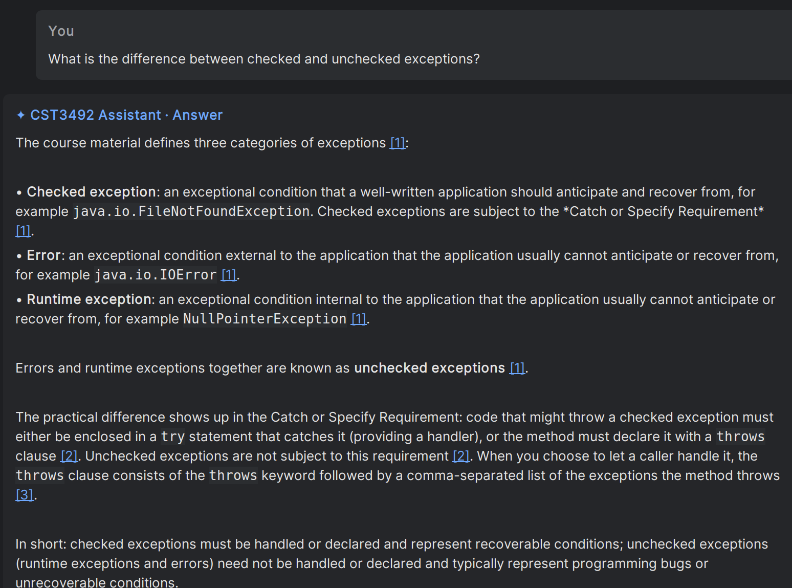
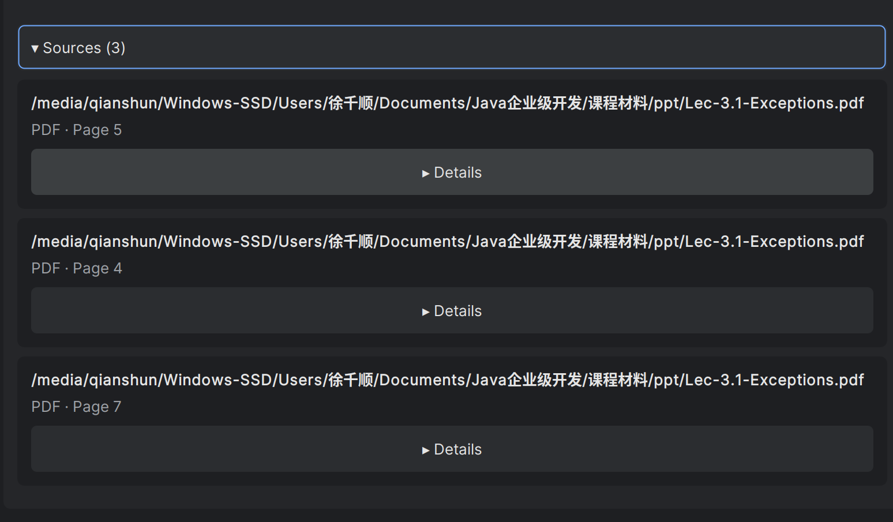

# Demonstration evidence for the English report and slides

These screenshots were captured by the operator on 25 and 26 October 2026 in the
Linux IDEA sandbox, using the Tongji AI platform. Images are unchanged copies of
the operator's captures. Sections 1–3 use clearly labelled generated demonstration
materials; the additional validation uses an actual course lecture PDF.
API keys are not shown.

## 1. Answers with course sources

**Suggested caption:** The assistant retrieves course passages and displays
verified document names and physical page/slide locations.

The operator asked about JDBC transaction rollback. The answer quoted the Demo
materials and the operator confirmed its citations. The two separate crops below
show the question and the expanded source list: PDF page 2, PPT slide 2 and PPTX
slide 2. They were captured during the initial `e8fa724` acceptance session.

## 2. General knowledge when no course source matches

**Suggested caption:** When the knowledge base has no relevant passage, the
assistant explicitly identifies its answer as general knowledge.

The question was about `java.time.LocalDate` formatting. This crop shows the
answer's ending and the required disclaimer. The operator separately confirmed
that the answer had no Sources list. Capture: initial `e8fa724` session.

## 3. Questions about selected Java code

**Suggested caption:** Selected editor code is attached separately to the
question, and the answer explains the actual branches of the selected method.

After restarting with the fix included in `918d9dc`, the operator repeated the
right-click workflow. The crop shows the question, attached method and answer:
`success=true` commits; `success=false` rolls back. The unverified source marker
seen during the earlier run is absent from the captured answer.

## Handoff to member D

- Use the real-course question and source-list crops below for the main course
  retrieval demonstration. Keep the Demo captures as repeatable test evidence,
  followed by the general-knowledge and selected-code scenarios.
- Preserve each image's proportions. Keep the source names/page labels and the
  general-knowledge statement readable when placing images on slides.
- Cite [the acceptance record](INTEGRATION_ACCEPTANCE.md) for the 156 passing
  automated tests, live-check results and remaining visual checks.
- The source code and plugin ZIP still need to be included with the team's final
  English report and slide PDFs, according to the assignment's packaging rules.

## Additional real-course validation

On 26 October the operator repeated the exceptions question using actual course
material and confirmed that the updated plugin displayed course sources. Safe
logs confirm a successful JSON-mode request with five retrieved/prompt chunks.
The two screenshots below have now been collected and visually inspected. The
first shows the question, answer and references [1]–[3]; the second shows the
expanded Sources list for `Lec-3.1-Exceptions.pdf`, with physical pages **5, 4 and
7**, in that order. Text extraction from the original PDF confirms that these
pages cover exception categories, the Catch or Specify Requirement, and the
`throws` clause, respectively. The source Details controls are collapsed in the
capture; the visible evidence establishes document/page references.

**Suggested caption:** The assistant answers a real course question and cites
the exception categories, handling requirements and throws clause from the
original lecture PDF (pages 5, 4 and 7).

Use the two crops together in the report. For slides, retain the question, a
readable answer excerpt, and the document/page labels rather than shrinking the
entire long answer to fit on one slide. These captures are preferred for the main
presentation; retain the Demo captures as repeatable fixture-based evidence.
