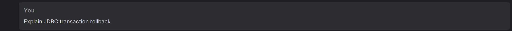
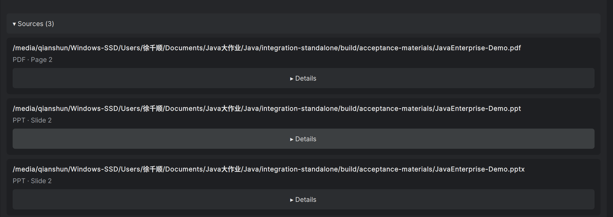
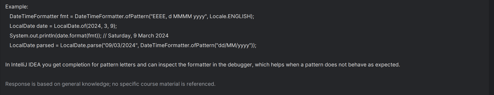
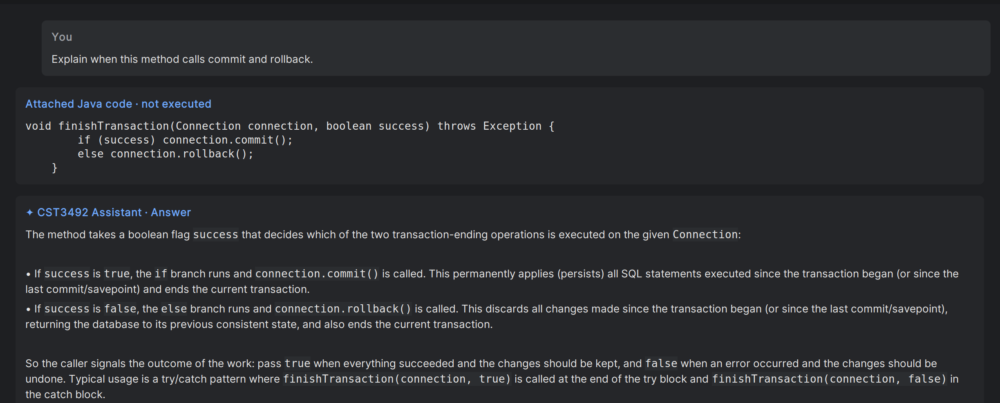

# Demonstration evidence for the English report and slides

These screenshots were captured by the operator on 25 October 2026 in the Linux
IDEA sandbox, using the Tongji AI platform. Images are unchanged copies of the
operator's captures. The documents are clearly labelled generated demonstration
materials, not official course lecture slides. API keys are not shown.

## 1. Answers with course sources

**Suggested caption:** The assistant retrieves course passages and displays
verified document names and physical page/slide locations.

The operator asked about JDBC transaction rollback. The answer quoted the Demo
materials and the operator confirmed its citations. The two separate crops below
show the question and the expanded source list: PDF page 2, PPT slide 2 and PPTX
slide 2. They were captured during the initial `e8fa724` acceptance session.

## 2. General knowledge when no course source matches

**Suggested caption:** When the knowledge base has no relevant passage, the
assistant explicitly identifies its answer as general knowledge.

The question was about `java.time.LocalDate` formatting. This crop shows the
answer's ending and the required disclaimer. The operator separately confirmed
that the answer had no Sources list. Capture: initial `e8fa724` session.

## 3. Questions about selected Java code

**Suggested caption:** Selected editor code is attached separately to the
question, and the answer explains the actual branches of the selected method.

After restarting with the fix included in `918d9dc`, the operator repeated the
right-click workflow. The crop shows the question, attached method and answer:
`success=true` commits; `success=false` rolls back. The unverified source marker
seen during the earlier run is absent from the captured answer.

## Handoff to member D

- Use these three scenarios as the demonstration sequence; the first scenario has
  separate question and source-list crops.
- Preserve each image's proportions. Keep the source names/page labels and the
  general-knowledge statement readable when placing images on slides.
- Cite [the acceptance record](INTEGRATION_ACCEPTANCE.md) for the 148 passing
  automated tests, live-check results and remaining visual checks.
- The source code and plugin ZIP still need to be included with the team's final
  English report and slide PDFs, according to the assignment's packaging rules.
